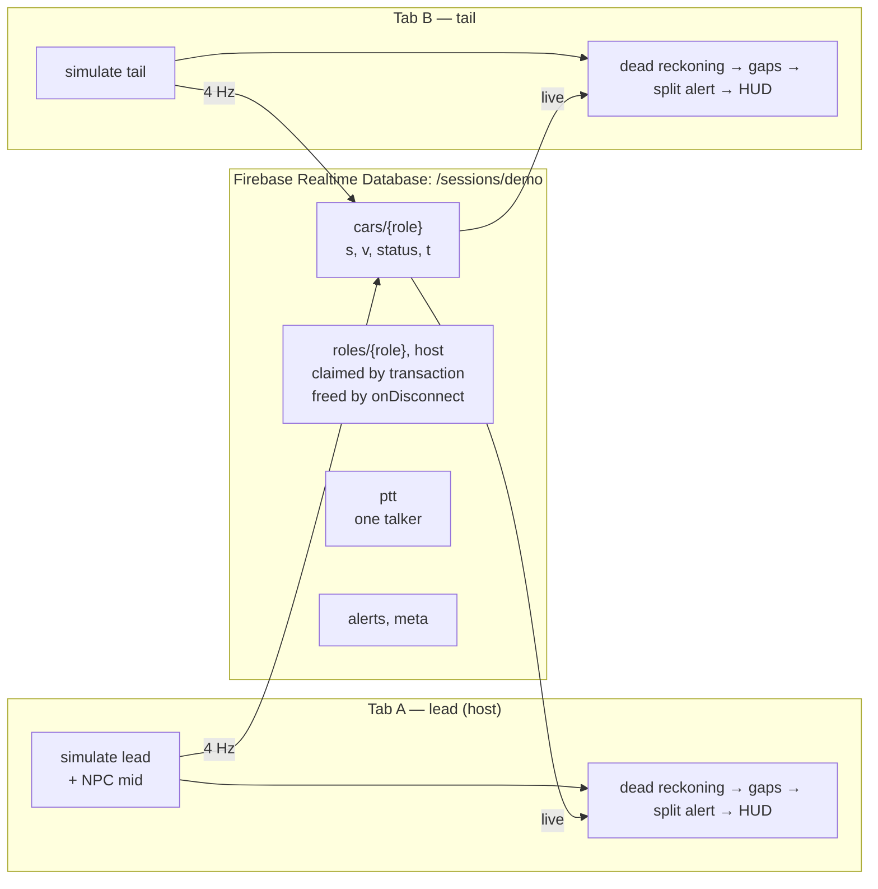

# Live Convoy HUD

A proof of concept of a driver's main screen for a car inside a live convoy. Three cars (Lead, Mid, Tail) drive a real mountain road up to Col de Turini, and every open browser tab is one of those cars. Tabs share positions, gaps, alerts and a push-to-talk channel in real time through Firebase Realtime Database. It's built with React, TypeScript and Leaflet, with no server of its own.

**Live demo: https://convoy-hud-poc.web.app**

To see two-tab sync, open these side by side (two windows work best):

- https://convoy-hud-poc.web.app/?role=lead
- https://convoy-hud-poc.web.app/?role=tail

A single tab also works: the tab that is "host" drives every empty seat as a simulated car (NPC).

### Things to try

| Feature | How |
|---|---|
| Convoy split alert | Click the gear (bottom-left of the map), drag **Tail lag** to 0.2. After about a minute the lead–tail gap passes 1.5 km and every tab shows **CONVOY SPLIT — SLOW DOWN AND WAIT** (with the Hebrew line from the brief). Drag the slider back to 1.0: the lead and mid "wait", and the alert clears below 1.2 km. |
| Pull over / breakdown | **Hold** the PULL OVER button for 0.6 s. Every tab shows "LEAD: PULLING OVER", your car stops, and the cars behind queue up 50 m apart. Tap RESUME to drive on. |
| Push-to-talk | Tap the page once on each device (browsers block sound until you do). **Hold** the talk button (or the Space bar on desktop) and speak, up to 8 s. Others see "LEAD TALKING" and a green ring on your car and hear a tone; when you let go, your message plays on their devices. A second talker is refused while the channel is busy. |
| Lost contact | Add `&debug=1` to the URL and press **Simulate network drop**: after 3 s the other cars dim and show "lost contact"; the host takes over your car until you reconnect. |
| Look around the map | Drag the map: following stops and a re-centre button appears. It also re-centres by itself after 15 s. Zooming keeps your car in the middle. |
| Start over | Gear → **Reset session** puts every car back at the start in all tabs. |

URL parameters: `role=lead|mid|tail` (default `mid`), `sid=<name>` for a separate session (default `demo`), `debug=1` for the debug overlay.

## Run locally

Requires Node 20+ and a (free) Firebase project.

```bash
npm install
cp .env.example .env.local   # then fill in the values, see below
npm run dev                  # http://localhost:5173
```

The `.env.local` values come from your own Firebase project:

1. In the [Firebase console](https://console.firebase.google.com), create a project. Analytics is not needed.
2. **Project settings → Your apps → Web app**. Copy `apiKey`, `authDomain`, `projectId` and `appId`.
3. Create a **Realtime Database** (any region) in locked mode. Copy its URL into `VITE_FIREBASE_DATABASE_URL`.
4. **Authentication → Sign-in method**: enable **Anonymous**.
5. Deploy the security rules from this repo: `npx firebase-tools login`, put your project ID in `.firebaserc`, then `npx firebase-tools deploy --only database`.

The Firebase web config is not a secret: it only names the project. The database rules are what protect the data.

Other scripts:

```bash
npm run typecheck   # TypeScript, strict
npm test            # Vitest, domain logic
npm run build       # production build into dist/
npx firebase-tools deploy --only hosting   # publish dist/ to Firebase Hosting
```

## Architecture

**Each tab owns one car.** A tab signs in anonymously, claims a role, simulates that car locally, and writes it to the database 4 times per second. Every tab reads all cars and computes gaps and alerts itself. If a seat has no human, the session **host** (the first tab to claim it) drives it as an NPC. There is no Node server: client-owned state plus a managed realtime database is enough for a POC (see [the trade-off](DECISIONS.md#client-owned-simulation-with-a-host-for-empty-roles-no-server)).



### Data model (`/sessions/{sid}`)

| Path | Content | Notes |
|---|---|---|
| `roles/{role}` | `{ uid, claimedAt }` | A human holds this car. Claimed by transaction, removed by `onDisconnect`. |
| `host` | `{ uid }` | The tab that drives empty seats as NPCs. Same claim pattern. |
| `cars/{role}` | `{ s, v, status, npc, t }` | `s` = metres along the road, `v` = m/s, `t` = server timestamp. |
| `ptt` | `{ role, uid, startedAt }` | The push-to-talk channel. Empty = free. |
| `alerts/{id}` | `{ type, role, t }` | `pullover` / `resume`. Append-only. |
| `clips/{id}` | `{ role, uid, mime, b64, t }` | Voice messages (base64 audio, about 43 KB for 8 s). Deleted after 30 s. |
| `meta` | `{ tailLag, resetAt }` | Shared demo settings (lag slider, reset). |

Rules ([database.rules.json](database.rules.json)): signed-in users only. `roles`, `host` and `ptt` can only be changed by their holder (or once the talk floor expires). Car samples are type- and range-checked.

### One telemetry update

1. Every 100 ms, `useConvoy` steps the cars this tab drives (`stepCar`: target speed, slower in corners, bounded acceleration).
2. `maybePublish` writes a car at most every 250 ms, and at least every 500 ms as a heartbeat. `t` is filled in by the server.
3. Other tabs receive the sample. Between samples they **dead-reckon** (`s + v × age`, capped at 3 s), and draw the marker easing toward that estimate. With no sample for 3 s the car freezes and shows "lost contact".
4. Each tab computes the gaps **along the road** and runs the split alert with **hysteresis** (on above 1.5 km, off below 1.2 km).

### One push-to-talk claim

1. Pointer down (or Space) → `takeFloor` runs a transaction on `ptt`. Inside it, the pure `claimFloor()` accepts only if the floor is free, held more than 30 s, or already ours.
2. In the same tap the microphone is requested (iOS refuses mic requests made after the tap). On success the tab registers `onDisconnect().remove()`, plays a tone, and `MediaRecorder` starts recording, for at most 8 s.
3. Other tabs see `ptt` change: "LEAD TALKING", a synthetic waveform, a green ring on the map marker, an opening tone. Their button is disabled.
4. Pointer up → recording stops, the clip is pushed to `clips/`, the mic closes and `ptt` is removed (closing tone). If the tab dies instead, the server removes `ptt` through `onDisconnect`.
5. Other tabs decode and play the clip, one message after another. The waveform shows the real playback level.

### Code layout

```
src/
  domain/     pure logic, no React or Firebase; unit-tested
              route (road lookup), sim (car physics), deadReckoning, convoy (gaps, split), pttFloor
  data/       the route waypoints (OpenStreetMap road via OSRM, simplified)
  firebase/   client (init, auth, server clock), session (role/host claims), telemetry, ptt, clips, alerts, meta
  audio/      Web Audio context, microphone analyser, voice message record/play, synthesized tones
  hooks/      useSession, useConvoy (the main loop), usePtt, useAlerts, useWakeLock
  ui/         MapView (Leaflet via a ref), Hud, ConvoyStrip, PttButton, Waveform, HoldButton, AlertBanner, DemoControls, DebugOverlay
```

About 1,550 lines of TypeScript excluding tests and route data.

## Requirements status

| # | Requirement from the brief | Status | Notes / why |
|---|---|---|---|
| 1 | Live map with 3 cars on a defined route | **Done** | Leaflet with OpenStreetMap tiles darkened by a CSS filter. The road is the real D70 up to Col de Turini (16.4 km each way, driven up and back in a loop). |
| 2 | Simulation updates position, speed, relative distance | **Done** | Pure `stepCar` with corner slowdown and bounded acceleration (tested). Speeds about 20–78 km/h; gaps shown in metres along the road. |
| 3 | Live channel between users | **Done** | Firebase Realtime Database, 4 Hz per car, server timestamps. |
| 4 | Bonus: two tabs sync live | **Done** | Each tab owns a car; the host drives empty seats; a closed tab's car is taken over where it was. Verified with two tabs and laptop + iPhone. |
| 5 | Large hold-to-talk PTT button | **Done** | 140 px (120 px on phone landscape), pointer capture, `touch-action: none`, Space bar on desktop. |
| 6 | "Transmitting now" state and who is talking | **Done** | Floor control by transaction: one talker at a time, "LEAD TALKING" on other tabs, green ring on the map, 30 s limit, freed if the talker's tab dies. |
| 7 | Waveform indicator | **Done** | Talker: live microphone level. Receivers: real level of the message as it plays; while someone is still talking (their audio hasn't arrived yet), a synthetic animation. |
| 8 | Audio transfer | **Done (recorded, not live)** | Tier 2 of 3: the talker's voice is recorded (up to 8 s) and played on the other devices **after they let go**, like a voice message. Tested iPhone Safari → Mac Chrome. Live streaming (WebRTC, tier 3) was not built. |
| 9 | Split alert beyond threshold | **Done** | Along-road lead–tail gap, on above 1.5 km, off below 1.2 km (tested). English message plus the Hebrew line from the brief. |
| 10 | Quick action "pull over / breakdown" | **Done** | Hold 0.6 s to confirm; broadcast banner on all tabs for 8 s; the cars behind queue 50 m apart and wait; RESUME drives on. |
| 11 | Dark, high-contrast, landscape HUD | **Done** | Landscape-first, compact phone-landscape layout, usable in portrait. Primary text contrast 14.8–17.8:1; secondary text about 5.3:1. No formal accessibility audit. |
| 12 | Live demo + GitHub + README | **Done** | https://convoy-hud-poc.web.app · https://github.com/bauermusic/convoy |

## Key decisions

Each has a short entry in [DECISIONS.md](DECISIONS.md) (context, decision, why, what two weeks would change).

- **Client-owned simulation, no Node server.** Each tab simulates its own car and a host tab drives empty seats. Simple, free to run, and two-tab sync is just the normal case. The cost: clients are trusted (no anti-spoofing).
- **Realtime Database over Firestore.** Built for many small, frequent writes. Presence comes built in (`onDisconnect`, `.info/connected`, server clock offset).
- **Distance along the road, not straight-line.** On hairpins two cars can be close through the air but far apart by road.
- **Hysteresis on the split alert.** On above 1.5 km, off below 1.2 km, so the alert doesn't flicker.
- **Dead reckoning with a 3 s cutoff.** Smooth markers between 4 Hz updates, and an honest "lost contact" when updates stop.
- **Transactions for every claim.** Role, host and talk floor all use a transaction plus `onDisconnect`, so two tabs never hold the same thing and a crashed tab frees it.
- **Leaflet with OpenStreetMap tiles.** No API key or billing account, which suits a public demo. CARTO's dark tiles (the original plan) now require a key, so standard OSM tiles are darkened with a CSS filter.
- **One anonymous user per tab.** Ownership is checked by uid, so each tab (even in the same browser) must be its own user.
- **Simulated drivers obey the split alert.** While split, the simulated lead and mid slow down, so the gap can close again.
- **The loop runs on a Web Worker timer.** Chrome slows timers in background tabs to once a minute, which would make a background tab's car look lost.

## Known limitations

- **Voice is delayed, not live.** A message plays after the talker releases the button, and is capped at 8 s. Tested iPhone Safari → Mac Chrome only; the Mac used for testing has no microphone, so Chrome → iPhone wasn't tested. If a browser can't decode the other's format (WebM/Opus vs MP4/AAC), it skips the message and logs a warning.
- **A frozen car is passed.** Cars keep 50 m behind the car ahead and queue behind a stopped one, but a car that lost contact (e.g. its phone went to sleep) is ignored, so the others drive past it rather than stopping behind a frozen marker.
- **Phones that sleep stop driving.** iOS pauses the page when the screen locks or another app is opened; that car shows "lost contact". The screen is kept awake (Wake Lock) where supported.
- **Clients are trusted.** Any signed-in user can write any car's telemetry (the host must write NPC cars). There is no per-session membership or rate limiting.
- **Stuck roles.** If a tab's disconnect is never detected, its seat stays taken. Reset doesn't release seats; deleting `sessions/<sid>/roles/<role>` does.
- **Single session at a time per URL**, a fixed route, and simulated positions only (no GPS).
- **Tests cover domain logic only**: route, simulation and car-following, dead reckoning, convoy gaps/split, floor control (29 tests). Realtime behaviour was verified by hand in two tabs and on a phone; there are no end-to-end tests.

## With two weeks instead of four hours

1. **Live audio:** WebRTC through an SFU (e.g. LiveKit), with the talk floor mapped to publish/mute. Keep today's recorded messages as the fallback for poor networks.
2. **Server-authoritative state:** positions come from devices (GPS) and are validated, smoothed and map-matched on a server. Clients can't spoof other cars. The simulation moves server-side for demos.
3. **Network drops in the field:** buffer the local car's samples while offline and replay them on reconnect, show how stale every car is, and adapt the publish rate to the connection.
4. **Security and scale:** per-convoy membership and invites, rules so that only the holder (or the server) writes a car, rate limits, many concurrent convoys, and cleanup of old sessions and anonymous users.
5. **Convoy logic:** time-gap (seconds) as well as distance alerts, configurable thresholds per convoy, and acknowledgements on alerts ("seen by LEAD").
6. **Mobile and in-car:** background behaviour and battery, a native shell or CarPlay / Android Auto integration, offline map tiles and a proper dark vector map style.
7. **Quality:** an accessibility audit, end-to-end tests with two browsers (e.g. Playwright), and monitoring.

## Browser notes

- Tested on Chrome (desktop) and Safari on iPhone. Everything except audio has no browser-specific code.
- Audio only starts after a user gesture: the first tap or key press on the page unlocks it. Until then, a receiver sees the talking indicators but hears no tone.
- The microphone needs HTTPS or `localhost`, and a permission prompt on the first press. Without a mic, push-to-talk still works as state only, and the button says why (e.g. "permission denied").
- Chrome records voice as WebM/Opus and Safari as MP4/AAC; each receiver decodes what it gets.
- Safari / iOS handle Web Audio and background tabs differently: a locked phone stops sending its car.

## Repository guide

- [BRIEF.md](BRIEF.md): the original requirements (translated from Hebrew).
- [SPEC.md](SPEC.md): the build plan written before coding. The code differs from it in places; each difference is logged in DECISIONS.md.
- [DECISIONS.md](DECISIONS.md): every shortcut, mock and design choice, with what two weeks would change.
- [PROGRESS.md](PROGRESS.md): phase log, time log and verification notes.
